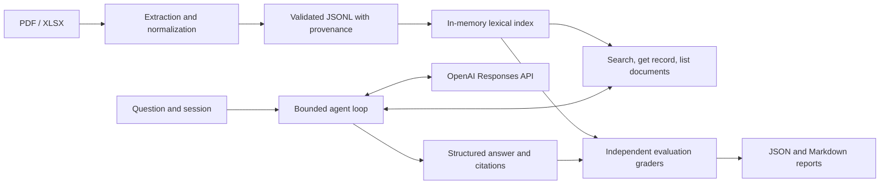

# SYDEN

SYDEN ingests construction PDFs and Excel BOQs, retrieves structured evidence, and uses a bounded agent to answer questions with original source references.

## Setup and commands

Python 3.12 or newer and `uv` are required. Install the locked dependencies:

```bash
uv sync --locked --group dev
uv run python main.py path/to/specification.pdf path/to/boq.xlsx
uv run python -m app.retrieval search concrete --processed-dir data/processed
```

For agent questions, set `OPENAI_API_KEY` and `OPENAI_MODEL` in the environment. See `.env.example` for provider settings and execution budgets. These commands make API requests:

```bash
uv run python main.py ask "What is the quantity of item 001?"
uv run python main.py chat
```

`/clear`, `/new`, and `/exit` manage in-memory conversations. Originals remain in `data/raw`; validated JSONL is written atomically to `data/processed`. These directories and `.env` are ignored by Git.

For OpenRouter, put its key and model ID in `.env`:

```dotenv
OPENAI_API_KEY=your_openrouter_key
OPENAI_BASE_URL=https://openrouter.ai/api/v1
OPENAI_MODEL=minimax/minimax-m3.1-flash:free
OPENAI_REASONING_EFFORT=low
OPENAI_MAX_OUTPUT_TOKENS=8192
```

Run `uv run --env-file .env python main.py chat`. The SDK reads the custom base URL; SYDEN detects OpenRouter and sends conversation history with `store=false`, without server-side response chaining. Only assistant messages and tool exchanges are retained for replay, within the existing session limits. OpenRouter receives tool schemas with optional search controls; application validation still enforces allowed fields, record kinds, and bounds. The chosen model/provider must support function calling and JSON-schema outputs. Debugging smoke tests do not establish live answer accuracy.

## Architecture



- `app/ingestion`: archives source bytes by SHA-256, extracts PDF text/tables and workbook cells/regions, and preserves numerical values, formulas, locations, and warnings.
- `app/retrieval`: validates JSONL, builds a lexical index, applies exact filters, ranks matches, and exposes pagination and incomplete-index diagnostics.
- `app/tools`: validates model arguments and dispatches three allowlisted, read-only operations. Returned evidence has original filename/page/sheet/row references and completeness flags.
- `app/agents`: calls the provider, executes iterative retrieval, validates structured answers and supplied citations, isolates sessions, and enforces request/tool/time/context budgets. Arithmetic remains LLM reasoning.
- `evals`: independently labelled synthetic fixtures, objective graders, offline scripted provider responses, optional live execution, timing, reports, and regression comparison. Production application modules do not import evaluation logic; the CLI loads it only for `eval`.

## Testing and evaluation

No API credentials or network access are required for the deterministic suite:

```bash
uv run ruff check .
uv run ruff format --check .
uv run pytest -q
uv run python main.py eval --mode offline
```

The default evaluation contains **54 explicitly synthetic cases**: 14 retrieval cases and 40 agent cases. It uses a committed corpus of 19 synthetic records, never the private files in `data/`. Offline responses are fixed transcripts; retrieval, tools, argument validation, orchestration, and grading actually execute. Passing these scripts does **not** measure live model accuracy.

Reports are written to `reports/latest.json` and `reports/latest.md`. Reports are ignored by Git. See [evaluation documentation](docs/evaluation.md) for schemas, metrics, thresholds, failure diagnosis, limitations, and paid live opt-in. GitHub Actions runs Ruff, pytest, and offline evaluation without secrets.

## End-to-end example

Ingest a BOQ with `main.py path/to/boq.xlsx`; the pipeline archives its bytes and writes JSONL records containing quantities, units, rates, amounts, and worksheet coordinates. Search `001` using `app.retrieval`, then ask the agent about that item. The agent can inspect the full record and cite its worksheet and row. An independently labelled evaluation case checks the answer against that record. The test `test_raw_workbook_to_ingestion_retrieval_agent_and_grading` exercises this whole path with a generated synthetic workbook and an offline provider.

## Limits

Retrieval is lexical and has known synonym gaps. PDF heading detection is heuristic; scanned PDFs require OCR that is not implemented. Workbook formula results require available cached values and may be stale. A valid citation establishes provenance, not semantic truth. Numerical answers and document-scope completeness still need independent checking. Model accuracy on real documents and paid API latency remain unmeasured until authorized live evaluations are run. The suite does not establish production readiness.
