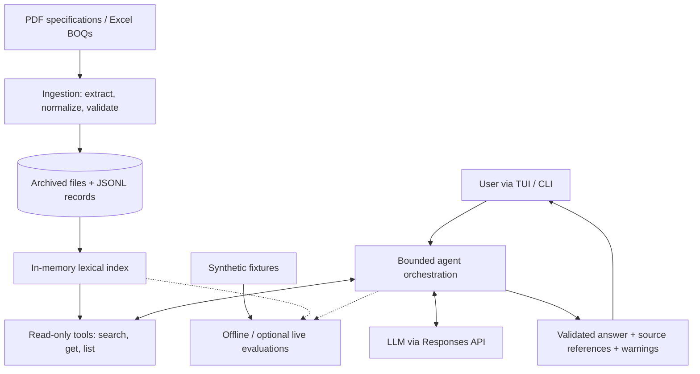

<div align="center">

# SYDEN

### Ask construction documents. Get answers grounded in source evidence.

**A terminal-first AI agent for construction PDFs, specifications, and Excel Bills of Quantities (BOQs).**

[](https://github.com/Ricardo-Ghattas/syden-agent/actions/workflows/checks.yml)


[Quick start](#quick-start) · [Features](#features) · [Architecture](#architecture) · [Usage](#usage) · [Evaluation](#testing-and-evaluation)

</div>

---

## Why SYDEN?

Construction information lives across long specifications, PDF tables, and complex BOQ spreadsheets. Answering *“How much reinforcement steel is required for the raft foundation?”* often means finding the right file, identifying an exact item, and checking its unit and context.

**SYDEN transforms these files into structured, searchable evidence and gives an LLM tools to investigate that evidence.** Answers carry references to original files, pages, worksheets, rows, and cell ranges when available.

SYDEN is also an **AI agent engineering showcase**: it demonstrates typed tool calling, bounded orchestration, evidence validation, failure handling, and reproducible evaluation—not merely a chat wrapper.

## Features

| Capability | What it provides |
| --- | --- |
| **Terminal-native interface** | Textual TUI with conversation history, shortcuts, real activity indicators, and readable answers. |
| **Integrated document import** | Select PDF/XLSX files from a built-in picker (`F3` or `/add`), or import paths directly. |
| **Structured ingestion** | PDF text/tables and workbook contents normalized into validated JSONL with original source positions. |
| **Evidence retrieval** | In-memory lexical search, exact-item lookup, filters, pagination, full records, and completeness warnings. |
| **Tool-using agent** | Three strict, read-only retrieval tools callable by the LLM. |
| **Traceable responses** | Validated answer format, source references, and explicit insufficient-evidence handling. |
| **Execution safeguards** | Budgets for iterations, calls, retries, elapsed time and context; isolated conversations and cooperative cancellation. |
| **Evaluation** | Deterministic tests, a synthetic offline benchmark, and opt-in live evaluation. |

## Quick start

**Requirements:** Python **3.12+** and [uv](https://docs.astral.sh/uv/).

```bash
git clone https://github.com/Ricardo-Ghattas/syden-agent.git
cd syden-agent
uv sync --locked --group dev
cp .env.example .env
uv run syden
```

The TUI allows **local imports without an API key**. For AI questions, edit `.env`:

```dotenv
OPENAI_API_KEY=your_api_key
OPENAI_MODEL=gpt-5-mini
```

Choose a model/provider with function calling and structured JSON-schema support. Never commit credentials.

### Use `syden` anywhere

```bash
uv tool install --editable .
syden
```

If your shell cannot find `syden`, run `uv tool update-shell` and reopen the terminal. An editable installation reuses your checkout's data and `.env`; keep the checkout at its installed location. A non-editable install (`uv tool install .`) uses user-level configuration; see the [TUI guide](docs/tui.md).

## Usage

### Import construction documents

Inside the TUI, press **F3** or enter `/add`, browse to PDFs/XLSX files, select them, then press **F2** to import. You can also use:

```bash
syden add "./documents/Project BOQ.xlsx" "./documents/specification.pdf"
```

Or type in the TUI:

```text
/add "./documents/Project BOQ.xlsx" "./documents/specification.pdf"
```

Importing makes **no LLM requests**. Original file bytes are archived under `data/raw/`; validated JSONL is stored under `data/processed/` by default. Repeated identical files are detected by content hash. Successful imports refresh the searchable collection without restarting SYDEN.

### Ask questions

```text
How much reinforcement steel is required for the raft foundation?

List concrete C35/45 items and show their quantities and units.

Which specification clause describes the concrete cover requirements?

Compare raft and slab quantities and cite the source BOQ rows.
```

A **synthetic example** of the information an answer can contain (not a verified real-project result):

```text
Question   What is the quantity of RC raft foundation concrete C35/45?

Answer     820.75 m³

Sources    Example.xlsx
           Sheet: Concrete | Row: 8
```

Ask a single question or output a structured response:

```bash
syden ask "What is the quantity of item 001?"
syden ask "What is the quantity of item 001?" --json
```

### TUI controls

| Action | Shortcut / command |
| --- | --- |
| Add documents | `F3` or `/add` |
| List imported documents | `/documents` |
| Show latest answer references | `/sources` |
| Send a question | `Enter` |
| Insert a newline | `Ctrl+O` or `F4` |
| New conversation | `Ctrl+N` or `/new` |
| Clear conversation context | `Ctrl+L` or `/clear` |
| Cancel an active operation | `Esc` |
| Help | `/help` |
| Exit | `Ctrl+Q` or `/exit` |

Conversation memory lives in the current process and is subject to limits; it is not persisted between launches. Cancellation does not revoke requests already transmitted to an API provider.

### Additional commands

```bash
syden chat                              # Legacy line-by-line chat
syden ingest ./documents/boq.xlsx       # Import alias
syden eval --mode offline               # Reproducible synthetic evaluation
syden --processed-dir ./data/processed  # Choose a document collection
syden --debug                           # Sanitized execution diagnostics

# Direct retrieval debugging:
uv run python -m app.retrieval search concrete --processed-dir data/processed
```

For configuration, file-picker behavior, import limits, cancellation semantics, and installation details, read [docs/tui.md](docs/tui.md).

## Architecture

SYDEN separates the **document pipeline**, **retrieval engine**, **tool boundary**, **agent**, and **terminal presentation**.



### From question to evidence-backed answer

1. **Ingest:** Files are archived by content hash. PDF/Excel extractors produce normalized records with page/worksheet/row references, values, and available formula caches.
2. **Index:** JSONL records populate a local lexical index with search, filtering, pagination, and full-record retrieval.
3. **Orchestrate:** The LLM iteratively invokes validated, allowlisted tools within time, context, and tool-call limits.
4. **Validate:** The agent validates the answer schema and checks cited locations against evidence exposed by its tools.
5. **Render:** Rich and Textual show the answer, source locations, and uncertainty warnings; JSON is available through the CLI.

**The three agent tools** are `search_documents`, `get_record`, and `list_documents`. They are read-only; they cannot run arbitrary shell commands or modify document contents.

### Engineering decisions and trade-offs

| Decision | Why it matters |
| --- | --- |
| **JSONL records with provenance** | Extraction stays independent of retrieval, while original locations remain inspectable. |
| **Lexical search rather than embeddings** | Simple and explicit for BOQ item codes, identifiers and filters, at the cost of weaker synonym matching. |
| **LLM-led numerical synthesis** | Questions about totals, quantities and amounts are handled in the agent's reasoning flow, not a deterministic spreadsheet calculator. The answer is not automatically guaranteed numerically correct. |
| **Strict tool schemas** | Invalid arguments, unknown operations, and malformed responses are handled at controlled boundaries. |
| **Bounded execution** | Iteration/tool/time/context budgets limit runaway loops and excessive retrieval. |
| **Offline evaluation** | Agent contracts can be regression-tested without paid inference calls or private documents. |

## Repository layout

```text
syden-agent/
├── app/
│   ├── cli.py            # Installed syden entry point and config
│   ├── tui/              # Textual UI, file picker, theme
│   ├── ingestion/        # PDF/XLSX extraction, normalization, archival, export
│   ├── retrieval/        # Index, filtering, ranking and search
│   ├── tools/            # Typed tool definitions and dispatch
│   └── agents/           # Provider adapter, state, orchestration, rendering
├── evals/                # Synthetic fixtures, graders and reporting
├── tests/                # Unit, integration, TUI and CLI tests
├── docs/                 # Detailed technical documentation
├── data/
│   ├── raw/              # Archived originals (not committed)
│   └── processed/        # Normalized JSONL (not committed)
├── main.py               # Backward-compatible legacy entry point
├── pyproject.toml        # Dependencies and package metadata
└── uv.lock               # Locked dependencies
```

**Stack:** Python · Textual · Rich · Pydantic · PyMuPDF · openpyxl · OpenAI SDK · uv · pytest · Ruff · GitHub Actions.

## Configuration and data handling

Use [`.env.example`](.env.example) for provider settings, retries, output limits, and `AGENT_*` execution budgets.

An OpenAI-compatible endpoint such as OpenRouter can be configured with:

```dotenv
OPENAI_API_KEY=your_openrouter_key
OPENAI_BASE_URL=https://openrouter.ai/api/v1
OPENAI_MODEL=your_tool_capable_model_id
```

For `syden`, configuration precedence is: explicit `--env-file`, then `~/.config/syden/.env` if present, then the editable checkout's `.env`. Existing environment variables take precedence. `SYDEN_DATA_DIR` overrides the default local document directory.

**Privacy:** Local import does not contact the LLM provider. **Asking an AI question can send retrieved excerpts of your documents to the configured API endpoint.** Review that provider's data-handling terms before using sensitive information.

## Testing and evaluation

```bash
uv run ruff check .
uv run ruff format --check .
uv run pytest -q
uv run syden eval --mode offline
```

The committed benchmark contains **54 synthetic cases** (14 retrieval + 40 agent cases), operating on **19 synthetic records**. Offline evaluation uses fixed provider transcripts; real tool validation, retrieval, orchestration and grading still run. It can assess tool behavior, citation support, numerical/unit assertions, abstention, and failure handling without API credentials.

Results are generated at `reports/latest.json` and `reports/latest.md`. GitHub Actions runs the deterministic checks on push and pull requests.

Optional live-model evaluation must be explicitly authorized and may incur costs:

```bash
uv run syden eval --mode live --allow-paid --output-dir reports/live
```

See [Evaluation & reliability](docs/evaluation.md) for case schemas, metrics, diagnostics, regression comparison and evidence limitations.

> **Evaluation scope:** Passing scripted synthetic cases is not proof of live-model correctness, real-document accuracy, or production readiness.

## Known limitations

- **Scanned documents:** OCR is not implemented; image-only PDFs can lack usable extracted text.
- **Document structure:** Heading detection is heuristic, and spreadsheet cached formula results can be absent or outdated.
- **Search:** Lexical retrieval may miss synonyms or paraphrases; no vector index is included.
- **Numerical reasoning:** The agent reasons over retrieved values rather than invoking a deterministic BOQ calculator. Totals and amounts require independent verification.
- **Provenance:** Valid citations show where evidence came from, not that an interpretation or computation is necessarily true.
- **Interaction:** Conversation state is in-memory, and the TUI presents validated final answers rather than streaming partial model output.
- **Operational scope:** This is an engineering project, not a certified construction cost or quantity verification system.

**Verify units, quantities, rates, document revisions, exclusions, and totals against authoritative project documents before using answers for engineering or commercial decisions.**

---

<div align="center">

Built to explore **reliable tool-using agents**, **document intelligence**, and **evidence-grounded answers**.

[Source code](https://github.com/Ricardo-Ghattas/syden-agent) · [TUI guide](docs/tui.md) · [Evaluation methodology](docs/evaluation.md)

</div>